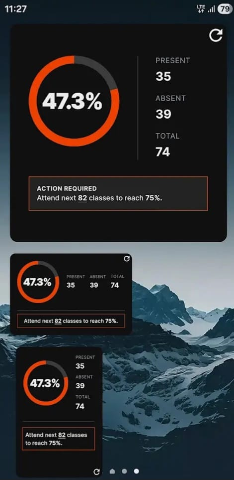
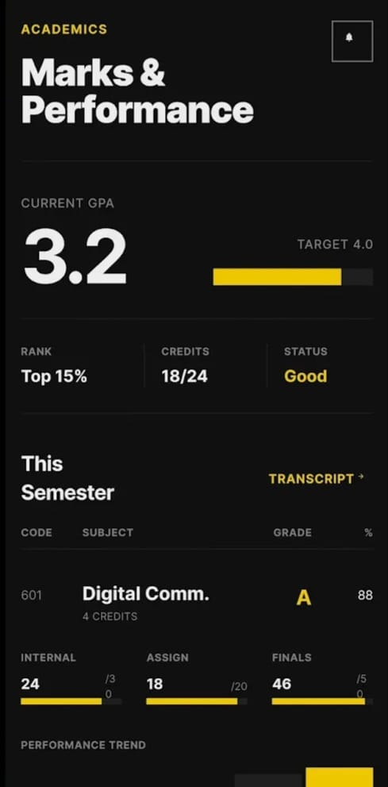
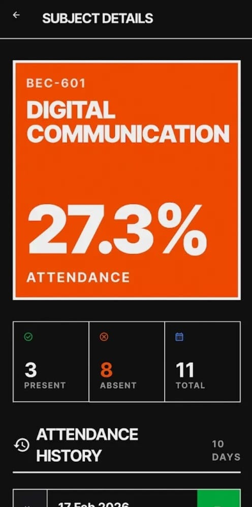
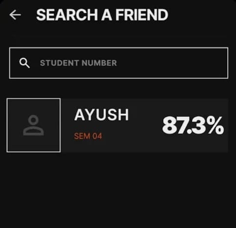
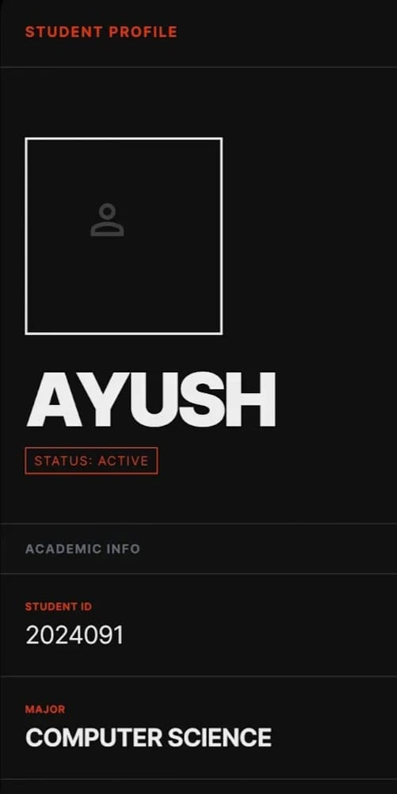
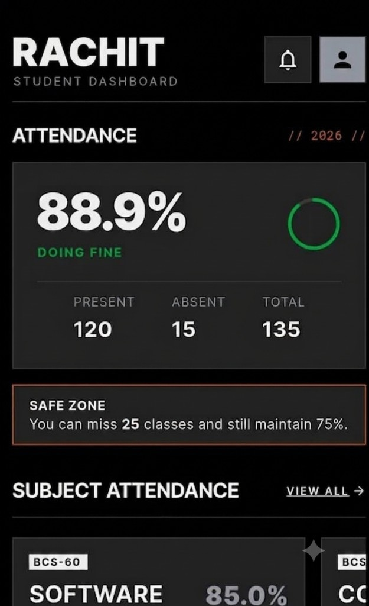

# AttenX

**AttenX** is a Flutter mobile app built for [AKGEC ERP](https://erp.akgec.ac.in) students. It brings attendance, timetables, marks, and social features into one place — with a modern dark UI that is easy to use every day.

**[Download on Google Play](https://play.google.com/store/search?q=attenx&c=apps&hl=en_IN)**

---

## Screenshots

<p align="center">
  
  
  
</p>
<p align="center">
  
  
  
  
</p>

---

## Features

### Attendance
- Overall attendance percentage with present, absent, and total counts
- **Safe Zone** — see how many classes you can miss and still stay above 75%
- **Action Required** — know exactly how many classes to attend to recover
- Subject-wise breakdown with expandable tiles and date-wise history
- Pull-to-refresh to sync live data from ERP

### Academics
- **Timetable** — day-wise schedule with theory/lab badges and room info
- **Marks & Performance** — GPA, credits, grades, and internal/assignment/final breakdown
- **Student Profile** — roll number, semester, section, and academic details

### Social
- **Search a Friend** — find classmates by student number and view their attendance

### Extras
- Android **home screen widgets** with live attendance stats
- **E-Identity** digital ID with barcode
- **Transport / technical training** attendance
- Custom animated backgrounds and force-update via Firebase Remote Config

---

## Tech Stack

| Category | Tools |
|---|---|
| Framework | Flutter, Dart |
| State Management | BLoC |
| Navigation | GoRouter |
| Networking | HTTP |
| Storage | Flutter Secure Storage, Shared Preferences |
| UI | Lottie, fl_chart, circlify, google_fonts |
| Widgets | home_widget |

---

## Project Structure

```
erp_app_v2/
├── lib/
│   ├── main.dart                      # App entry, Firebase init, BLoC setup
│   ├── main_shell.dart                # Bottom navigation (5 tabs)
│   ├── widget_background_callback.dart
│   │
│   ├── core/
│   │   ├── router/                    # GoRouter — splash, force update
│   │   ├── update_check/              # Firebase Remote Config
│   │   └── customizer/                # Background themes
│   │
│   └── features/
│       ├── auth/                      # Login, splash, session handling
│       ├── home/                      # Dashboard, drawer screens
│       ├── attendance/                # Repos, BLoC, subject tiles
│       ├── profile/                   # Student profile
│       └── timetable/                 # Timetable & transport attendance
│
├── assets/                            # Icons, Lottie animations, backgrounds
├── android/                           # Native Android + home widgets
└── docs/screenshots/                  # App screenshots
```

---

## Data Flow

AttenX connects directly to the official AKGEC ERP API. No separate backend is required for core features.

```
┌──────────┐     POST /Token      ┌─────────────┐
│  Login   │ ───────────────────► │  ERP Server │
└──────────┘                      └─────────────┘
      │                                   │
      │  tokens saved                     │  profile, attendance,
      ▼                                   │  timetable, marks
┌──────────────┐                          │
│ Secure Store │ ◄────────────────────────┘
└──────────────┘
      │
      ▼
┌──────────────┐     BLoC state     ┌──────────────┐
│ Repositories │ ────────────────► │  UI Screens  │
└──────────────┘                   └──────────────┘
      │
      ▼
┌──────────────┐
│ Home Widget  │  ← attendance synced on refresh
└──────────────┘
```

**Key endpoints:** `/Token` · `/api/User` · `/api/SubjectAttendance` · `/api/TransportAttendanceReport`

---

## Getting Started

### Prerequisites
- Flutter SDK ≥ 3.10
- Android Studio or VS Code
- Valid AKGEC ERP login credentials

### Run locally

```bash
git clone <repo-url>
cd erp_app_v2
flutter pub get
flutter run
```

### Build release APK

```bash
flutter build apk --release
```

---

## Credits

Designed and developed with love by **Rachit Daksh**

---

> AttenX is an unofficial third-party client for AKGEC ERP and is not affiliated with Ajay Kumar Garg Engineering College.
